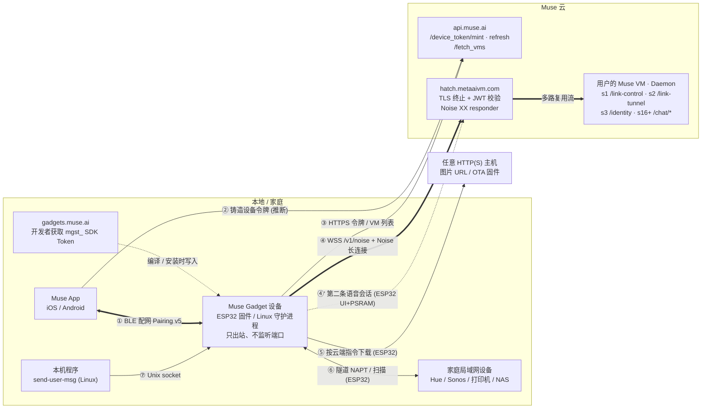
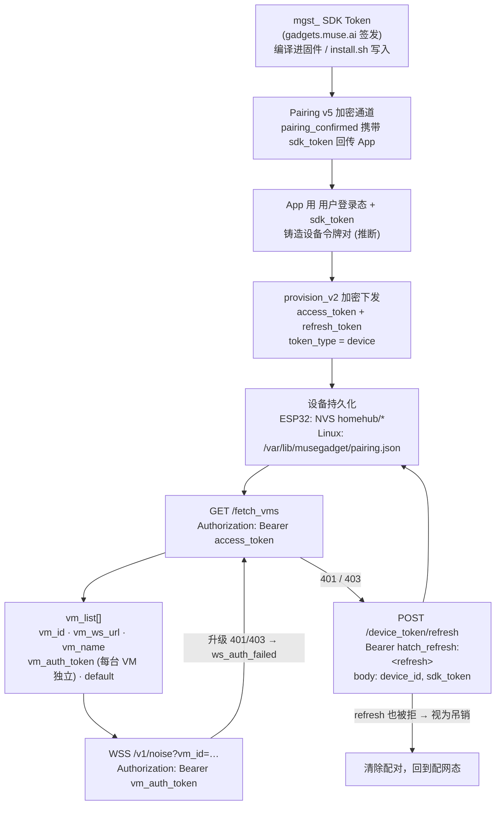
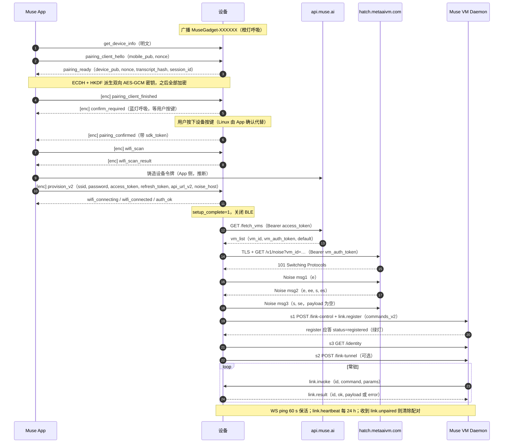

# Muse Gadget SDK：端云通信架构

> 基于本仓库源码（`esp32/` 固件与 `linux/` 守护进程）梳理，只描述 SDK 侧能看到的行为。
> 云端内部实现不在仓库里，凡是从客户端代码和注释**推断**出来的云侧行为都会标注“推断”。

## 0. 一句话结论

设备本身不跑 AI。它是用户云端 **Muse VM**（每个用户一台的 Agent 虚拟机）的“手脚”，
负责执行命令、上报数据、采集语音，也可以给 VM 开一条通往家庭局域网的隧道。

- **手机 App 只在配网时出场。** 它通过 BLE（应用层加密）把 Wi‑Fi 和**设备令牌**交给设备，配完就退出。
- **之后设备只连两个云端入口：**
  1. `api.muse.ai`：HTTPS 短请求，用来换令牌、查 VM 列表；
  2. `hatch.metaaivm.com`：`WSS /v1/noise` 长连接，上面再跑一层 **Noise XX 加密**。
- **连接只由设备向外建立**，设备不监听任何端口。云侧通过这条长连接反向调用设备（`link.invoke`），所以设备放在 NAT 后面也能用。
- **长连接上多路复用**控制面（`/link-control`）、数据面（`/link-tunnel`）、身份（`/identity`）和聊天（`/chat/*`）等多条流。

---

## 1. 参与方

| 角色 | 是什么 | 在代码里的体现 |
|---|---|---|
| **Muse App** | iOS/Android App，在 Settings › Devices › Developer mode 下添加 `MuseGadget-XXXXXX` | BLE 客户端；向云端铸造设备令牌（App 侧实现不在仓库） |
| **设备：ESP32** | ESP‑IDF 固件，入口 `esp32/main/main.c`，主逻辑 `esp32/main/app.c`。带屏板子另有 `components/muse` UI | 两种 BLE 角色：配网 GATT（`ble_server.c`）、可选的 Muse 伴侣服务（`muse_ble.c`） |
| **设备：Linux** | Python 包 `musegadget`，以 systemd 服务常驻 | `link_client.py` / `service.py` / `muse_api.py` |
| **gadgets.muse.ai** | 开发者门户，签发 `mgst_…` SDK Token | 设备运行时**不访问**它。Token 在编译期（ESP32 的 `CONFIG_GADGET_SDK_TOKEN`）或安装时（Linux 的 `install.sh --sdk-token`）写入 |
| **api.muse.ai** | 账号/设备令牌 API（可被配网下发的 `api_url_v2` 覆盖） | `esp32/main/vm_api.c`、`linux/.../muse_api.py`、`components/muse/muse_account_api.c` |
| **hatch.metaaivm.com** | VM 接入边缘：TLS 终止，并在 WebSocket 升级时校验 JWT；其后是 Noise responder（rev‑proxy）。分层细节属推断，依据是 `noise_upgrade.h`、`noise_control.cpp:744-759` 的注释 | 可被配网下发的 `noise_host` 覆盖 |
| **Muse VM / Daemon** | 用户的 Agent。通过 Noise 会话上的 `Daemon` 服务暴露 `/link-control`、`/link-tunnel`、`/identity`、`/chat/*` 等 HTTP 风格接口 | `ServiceType::Daemon`（另有 Sentinel/Vault/Authd，设备侧没用到） |
| **家庭局域网** | 灯、音箱、打印机、NAS… | 隧道 NAPT 出口和 `device.discover` 扫描的对象 |

---

## 2. 整体架构图



文字版（终端也能看）：

```
            ┌────────────────────────── Muse 云 ───────────────────────────┐
            │                                                              │
            │   api.muse.ai (HTTPS)            hatch.metaaivm.com (WSS)    │
            │   ├ POST /device_token/mint      ├ TLS 终止 + JWT 校验       │
            │   ├ POST /device_token/refresh   └ Noise XX responder        │
            │   └ GET  /fetch_vms                    │                     │
            │        ▲        ▲                      ▼                     │
            │        │②       │③           ┌─ 用户 Muse VM: Daemon ─────┐  │
            │        │        │            │ s1  POST /link-control     │  │
            │        │        │            │ s2  POST /link-tunnel      │  │
            │        │        │            │ s3  GET  /identity         │  │
            │        │        │            │ s16+ POST /chat/stream|sub │  │
            │        │        │            └────────────▲───────────────┘  │
            └────────┼────────┼─────────────────────────┼──────────────────┘
                     │        │                         │ ④ WSS + Noise 长连接（常驻，设备主动出站）
   ┌─────────┐  ①BLE │   ┌────┴─────────────────────────┴───┐ ⑤ HTTP(S) GET ┌──────────┐
   │Muse App │◄──────┴──►│  Muse Gadget (ESP32 / Linux)     │──────────────►│ 图片/OTA │
   └─────────┘ 配网+令牌 │  NVS / pairing.json 保存令牌     │               └──────────┘
                         └──────┬───────────────────────────┘
                                │ ⑥ 隧道 NAPT / 局域网扫描 (仅 ESP32 且需 PSRAM)
                         ┌──────▼────────┐
                         │家庭局域网设备 │
                         └───────────────┘
```

---

## 3. 连接清单（端 ↔ 云 / 端 ↔ 端）

| # | 链路 | 方向 / 端点 | 传输与认证 | 承载内容 | 生命周期 | 平台 |
|---|---|---|---|---|---|---|
| ① | **BLE 配网** | App ↔ 设备，GATT 服务 `7fdd3d1c-38ea-46cf-8b46-314ecf5f240c`（RX `4d593029…`，TX `d75dc4ca…`） | BLE 不开链路层加密；应用层用 Pairing v5（P‑256 ECDH → HKDF‑SHA256 → AES‑256‑GCM）。分片格式 `[0xFE, idx, total, payload]` | `get_device_info`、`pairing_client_hello` / `finished`、`wifi_scan`、**`provision_v2`**（Wi‑Fi + 设备令牌 + `api_url_v2` + `noise_host`）、`unpair`、`device.ota` | 只在配网窗口内广播；配完关闭 BLE | ESP32、Linux |
| ①' | **BLE 伴侣服务** | App/工具 ↔ 带屏 Muse 板，服务 `4d757365-0001-…` | LE Secure Connections + passkey + bonding | `key=value` 文本：`wifi.*`、`hatch.host` / `vm` / `token`、音量、亮度… | 按需 | ESP32 UI 板 |
| ② | **App → 账号 API**（推断） | App → `api.muse.ai` | App 用户登录态，加上设备在 `pairing_confirmed` 里回传的 `sdk_token` | 铸造 `token_type=device` 的 access/refresh 令牌对 | 一次性 | — |
| ③ | **设备 → 账号 API** | `https://api.muse.ai`（或 `api_url_v2`） | HTTPS + 公共 CA bundle；`X-API-Version: 1.0.0`；重定向由代码手动处理，只有同源跳转才保留 `Authorization` | `GET /fetch_vms`（`Bearer <设备 access_token>`）<br>`POST /device_token/refresh`（`Bearer hatch_refresh:<refresh>`，body `{device_id, sdk_token}`）<br>`POST /device_token/mint`（仅 ESP32 迁移旧令牌时用） | 短连接，按需。4 次重试，500 ms 起指数退避 | ESP32、Linux |
| ④ | **主长连接（控制面 + 数据面）** | `wss://hatch.metaaivm.com/v1/noise?vm_id=<id>` | TLS → WebSocket（升级时带 `Authorization: Bearer <vm_auth_token>`）→ `Noise_XX_25519_AESGCM_SHA256` → 多路复用 ServiceFrame | 见 §6 流分配：`/link-control`、`/link-tunnel`、`/identity`、`/chat/*` | 常驻、自动重连。ESP32 退避 1–15 s，鉴权失败 60 s；Linux 2–60 s | ESP32、Linux |
| ④' | **Muse 语音会话** | 与 ④ 相同的端点、同一个 `vm_auth_token`，但**另开一条** TLS + WSS + Noise | 同 ④ | 常开 `POST /chat/subscribe`（NDJSON 事件流）+ 每轮 `POST /chat/stream`（语音 WAV base64 / 文本） | 20 s ping；空闲 10 分钟断开；退避 5–120 s | 仅 ESP32 带 PSRAM 的 UI 板（`CONFIG_MUSE_HATCH=y`）和 Voice PE |
| ⑤ | **出站下载** | 设备 → **云端下发的任意 URL** | 普通 HTTP(S)，不带凭据 | `display.draw_url` 拉图片；`device.ota` 走 `esp_https_ota` 拉固件（安装前做 RSA 签名校验） | 按命令触发 | ESP32 |
| ⑥ | **家庭局域网** | 设备 ↔ LAN | lwIP 自定义 netif `tn`（设备 10.42.0.1，VM 10.42.0.2）+ NAPT | VM 发来的 IPv4 包经 Wi‑Fi 出口转发；`device.discover` 用 ARP/mDNS/SSDP/WS‑Discovery/SNMP/NetBIOS 扫描 | 跟随 ④ | ESP32（`CONFIG_HOMEHUB_TUNNEL`，需 PSRAM） |
| ⑦ | **本机 → 设备守护进程** | 本机程序 → `/run/musegadget/musegadget.sock` | Unix socket，单行 JSON，权限 root:run‑as 组 0660 | `{"message", "session_id"?}`，再转成 ④ 上的 `POST /chat/stream` | 按需 | Linux |

---

## 4. 主长连接的协议栈

ESP32 的 `esp32/components/noise_core` 和 Linux 的 `linux/src/musegadget/noise/` 是同一协议的 C++ / Python 两份实现，两端各有主机侧测试（ESP32 `tests/test_noise_core.py`，Linux `tests/test_link_client.py` 内置一个做真实 Noise 握手的假 VM）。BLE 配对协议则两端共用测试向量 `tests/vectors/link_pairing_v5.json`。

```
┌──────────────────────────────────────────────────────────────────────────┐
│ 应用层   /link-control : [u32-LE 长度][JSON] 双向消息流                   │
│          /link-tunnel  : [u16-LE len][IPv4 包] ... 批（≤8 KB / ≤16 包）   │
│          /chat/*       : JSON 请求 → JSON ack / NDJSON 事件流             │
├──────────────────────────────────────────────────────────────────────────┤
│ ServiceFrame (protobuf)   stream_id + oneof {                             │
│     Request{verb, path, headers, body, end_body} | Response{status, ...}  │
│     | BodyChunk{data, end_body} | Reset{code, reason} }                   │
├──────────────────────────────────────────────────────────────────────────┤
│ ServiceRequestEnvelope    service = Daemon(0) | Sentinel | Vault | Authd  │
├──────────────────────────────────────────────────────────────────────────┤
│ NoiseTransportFrame       chunk_id · chunk_index · total_chunks · payload │
│                           （单片 ≤64 KB，重组后 ≤16 MB）                  │
├──────────────────────────────────────────────────────────────────────────┤
│ Noise_XX_25519_AESGCM_SHA256 传输加密：每个 WS 二进制消息 = 1 个 AEAD 密文 │
│   握手 msg1(e) → msg2(e, ee, s, es) → msg3(s, se)，msg3 payload 为空      │
├──────────────────────────────────────────────────────────────────────────┤
│ WebSocket（RFC 6455 二进制帧）  GET /v1/noise?vm_id=…                     │
│   Authorization: Bearer <vm_auth_token>；保活 ping：ESP32 60 s，Linux 20 s │
├──────────────────────────────────────────────────────────────────────────┤
│ TLS（esp_tls + 公共 CA bundle / Python ssl）→ TCP 443                     │
└──────────────────────────────────────────────────────────────────────────┘
```

要点：

- **谁认证谁。** 设备的 Noise 静态密钥**每个会话现生成**，不持久化；设备也**不校验服务端 Noise 静态公钥**（没有 pin）。所以“设备是谁”只靠升级请求里的 bearer（`vm_auth_token`，按注释是边缘校验的 JWT），“服务端是谁”只靠 TLS 证书链。见 `noise_core/src/InitiatorHandshake.cpp:353`、`linux/.../noise/noise_xx.py`。
- **msg3 的载荷必须为空。** 代码注释说，rev‑proxy 要求 msg3 是合法的 protobuf `NoiseHandshakeMessage3`，空消息正好编码成 0 字节；以前塞 token 字符串会被立刻断开（`noise_control.cpp:744-759`）。
- **鉴权失败要单独处理。** 升级返回 401/403 时归类为 `AUTH_REJECTED`，触发重新 `fetch_vms` 拿新的 `vm_auth_token`，不会原样重试旧令牌（`noise_upgrade.h`）。

---

## 5. 凭据链：从 SDK Token 到 VM 长连接



- **设备身份**：`node_id = homelink-xxxxxx`（ESP32 取 STA MAC 后 3 字节；Linux 取 `identity.json` 里随机生成的本地管理 MAC），另有 `device_id = hatch-link:<mac>`。刷新令牌时的 `device_id` 字段填的就是 `node_id`。
- **VM 选择**：优先用户通过 `device.set_vm` 指定、保存在 NVS 的 `vm_url`，否则用 `default=true` 的那台。`vm_id` 和 `vm_auth_token` 必须来自**同一条** `fetch_vms` 记录，不允许拿别的 VM 的令牌兜底（`vm_connect.h`）。
- **两端的刷新策略不同**（值得关注）：
  - ESP32 注释认为设备 access token 有效期是 **365 天**，只在被拒、每 30 天（`CONFIG_HOMEHUB_TOKEN_REFRESH_INTERVAL_DAYS`）或每次启动上报一次 SDK token 时才刷新（`app.c:844-851`）；
  - Linux 假定有效期约 **4 小时**，令牌满 3 小时就刷新（`service.py:52`）。

---

## 6. 一条 Noise 会话上的流分配

| stream_id | 请求 | 方向 / 内容 | 何时打开 |
|---|---|---|---|
| 1 | `POST /link-control`（body 不关闭） | 双向 u32‑LE 长度前缀 JSON；出站按 ≤8 KB BodyChunk 切片 | 握手完成后立即打开 |
| 2 | `POST /link-tunnel` | 双向 IPv4 包批；20 s 空闲发 1 字节保活，65 s 无入站判死，每 5 s 重试 | `link.register` 得到确认之后（ESP32 + TUNNEL） |
| 3 | `GET /identity` | 一次性取 Agent 名字（`{"ok":true,"result":{"name":…}}`），用于屏幕显示 | 注册后一次 |
| 16+ | 任意 `noise_ctrl_req_open()` 请求，最多 3 个并发 | 无 PSRAM 的 UI 板走这里：`/chat/subscribe` + `/chat/stream` | 每轮语音 |

Linux 的分配：stream 1 = `/link-control`，2、3… = 每条 `send-user-msg` 对应的 `POST /chat/stream`。

---

## 7. 时序：从开箱到被 Muse 调用



---

## 8. `/link-control`：控制面 RPC

方向是**云调用端**：设备注册时声明“我会什么”，VM 里的 Agent 按需 `invoke`。

```jsonc
// 设备 → VM：注册（每次会话一次，整条消息 ≤ 8 KB）
{"type":"req","id":"<uuid>","method":"link.register","params":{
  "node_id":"homelink-a1b2c3","display_name":"…",
  "platform":"esp32","device_family":"link","model_id":"esp-link",   // Linux: "linux" / "homehub" / "linux"
  "version":"999.0.0","is_wakeup_supported":false,
  "metadata":{"network_ssid":"…"},
  "commands_v2":{"device.health":{"description":"…","required":{},"optional":{}}, "…":{}}}}

// VM → 设备：调用
{"method":"link.invoke","id":"<req-id>","command":"display.draw_url","params":{"url":"https://…"},"timeout_ms":30000}

// 设备 → VM：结果
{"method":"link.result","id":"<req-id>","ok":true,"payload":{…}}

// 设备 → VM：心跳（注册成功后 24 h 一次）
{"method":"link.heartbeat"}

// VM → 设备：事件
{"type":"event","event":"link.unpaired"}   // 或 node.unpaired → 设备清除配对并重启
```

### 设备暴露给 Muse 的命令

| 命令 | 作用 | ESP32 开关 | Linux |
|---|---|---|---|
| `device.health` | 运行时长、内存、电池/USB、SSID、版本 | 总是 | ✓（负载、磁盘、温度） |
| `device.discover` | 局域网扫描（ARP、mDNS、SSDP、WS‑Discovery、SNMP、NetBIOS），超时 90 s | `HOMEHUB_TUNNEL` | — |
| `display.draw_url` / `display.show_animation` | 按 URL 下载并显示图片 / 回到动画 | `HOMEHUB_DISPLAY_COMMANDS` | — |
| `voice.configure` | 读写音量 | `HOMEHUB_VOICE` | — |
| `sensors.read` | CO2、tVOC、温湿度等 | SenseCAP / reTerminal 传感器 | — |
| `camera.capture` | 拍一张 JPEG，base64 编码后放在 `link.result` 里回传 | `MUSE_WATCHER_CAMERA` | — |
| `device.ota` | 从给定 URL 做 OTA，签名校验后安装 | `HOMEHUB_OTA_ENABLED` | **刻意不支持**（服务端会给所有 `device_family=link` 的设备推 ESP32 固件） |
| `system.run` / `file.read` / `file.write` | 以安装时指定的账户执行 shell、读写文件（每块 64 KB） | — | ✓ |
| `device.list_vms` / `set_vm` / `reset_vm` / `unpair`、`bug.report` | 管理类命令，**不在 register 里声明**，但会处理 | 总是 / `SUPPORT_BUG_REPORT` | — |

在 ESP32 上新增命令要改两处：`noise_control.cpp` 的 `build_register_json()` 负责声明，`app.c` 的 `on_ws_command()` 负责处理。耗时的命令要另起任务异步执行，完成后调用 `noise_ctrl_send_command_result()` 回传结果。

---

## 9. 端发起的上行：语音与消息

`/link-control` 是“云调用端”。反方向“端主动找 Muse 说话”走 `/chat/*`：

| 场景 | 承载方式 | 请求 |
|---|---|---|
| ESP32 带屏、有 PSRAM（`CONFIG_MUSE_HATCH=y`） | **另开一条** Noise 会话（链路 ④'） | 长开 `POST /chat/subscribe`（NDJSON 事件：`delta.text_append`、`message.assistant`…）+ 每轮 `POST /chat/stream` |
| ESP32 带屏、无 PSRAM（C6‑1.8/2.06、AI Passport、Cardputer） | 复用主会话 ④ 的 16+ 号流 | 同上，每轮按需打开 |
| Linux `send-user-msg` / Unix socket | 复用主会话 ④ | `POST /chat/stream`，body 为 `{message, output_modality:"text", device_id, session_id?}`，只拿回 `message_id` ack，回复出现在 App 聊天里 |

- **上行内容**：按住说话期间，`{"message":"","output_modality":"text","items":[{"type":"file","mime_type":"audio/wav","data_base64":…}]}` 以 BodyChunk 流式上传，音频是 16 kHz 单声道 PCM16 的 WAV。
- **下行内容**：**只有文本**。设备把回复做成字幕显示；`start_tts` 是留给开发者自己接 TTS 的空桩，云端不下发音频。
- **请求头**：`x-request-id`；`x-app-id`，ESP32 填 `hatch-web`，Linux 填 `musegadget`。

---

## 10. ESP32 与 Linux 对比

| 维度 | ESP32 固件 | Linux 守护进程 |
|---|---|---|
| 配网确认 | 物理按键（`confirm_press`） | App 端确认（`confirm_app`），只在 `musegadget pair` 运行时广播 |
| Wi‑Fi | 由 `provision_v2` 下发并加入 | 机器本来就在线；只报告当前网络，忽略下发的 SSID/密码 |
| 令牌 | App 铸造；设备只在迁移旧令牌时自己 mint | App 铸造；设备**从不** mint |
| register | `platform=esp32`、`device_family=link` | `platform=linux`、`device_family=homehub`（必须如此，避免被推 ESP32 OTA） |
| 数据面隧道 | 有（`/link-tunnel` + NAPT，需 PSRAM） | 无 |
| OTA | 有（命令触发，RSA 签名校验） | 无（用 `install.sh` / pip 更新） |
| 上行聊天 | 语音笔记（带屏板） | 文本，`send-user-msg` / Unix socket |
| 应用层心跳 | `link.heartbeat` 每 24 h，外加 WS ping 60 s | 只有 WS ping 20 s |
| 状态存储 | NVS 命名空间 `homehub`、`muse`（建议开 NVS 加密） | `/var/lib/musegadget/{identity,pairing}.json`（0700） |

---

## 11. 值得注意的设计点与风险

1. **只有出站连接。** 设备不开任何端口，云端能力全靠长连接反向调用实现，因此放在 NAT 后面也能工作。这也意味着长连接一断，Muse 就完全够不到设备。
2. **身份认证的分工。** Noise 不 pin 服务端静态公钥，设备静态密钥每会话一换，服务端身份完全依赖 TLS CA 链。Noise 层的作用（推断）是：TLS 在边缘终止后，边缘到 VM 这一段仍然加密。
3. **隧道等于让 VM 进了你的局域网。** `tn` 接口加 NAPT，`tunnel_netif.c` 里没有地址或端口过滤，VM 能访问 Wi‑Fi 可路由的所有地址。
4. **云端下发的 URL 不受限制。** `display.draw_url` 和 `device.ota` 都接受任意 http(s) URL，没有白名单。OTA 有 RSA 签名校验兜底，但开发构建用的是仓库里提交的 `dev_signing_key.pem`。`draw_url` 的错误信息会带回 HTTP 状态码，等于可以用它探测局域网 HTTP 服务。
5. **SDK Token 随固件分发。** 官方文档也说要把它当“标识”而不是密码，泄露了就去 gadgets.muse.ai 吊销。
6. **两条 VM 会话的 host 可能不一致。** 带 PSRAM 的 UI 板，语音会话 ④' 连的是 NVS `muse/host`，不是主链路配置的 `noise_host`（Voice PE 例外）。
7. **令牌刷新策略不一致。** 见 §5：ESP32 尽量少刷新（注释说 refresh 接口在闲置后可能签发不可用的令牌），Linux 每 3 小时刷新一次。

---

## 12. 代码索引

| 主题 | ESP32 | Linux |
|---|---|---|
| 入口 / 编排 | `esp32/main/main.c`、`app.c`（`app_run`、`on_provision`、`fetch_vms_with_refresh_with_gate_held`、`on_ws_command`、`on_ws_control_status`） | `cli.py`、`service.py` |
| 账号 API | `esp32/main/vm_api.c`、`vm_connect.h` | `muse_api.py` |
| 主长连接 | `esp32/main/noise_control.cpp`、`noise_upgrade.h` | `link_client.py` |
| Noise 协议实现 | `esp32/components/noise_core/` | `noise/{noise_xx,transport,framing,envelope}.py` |
| BLE 配网 | `esp32/main/ble_server.c`、`link_pairing.c`、`pairing_transcript.c` | `ble_server.py`、`ble_setup.py`、`pairing.py`、`ble_framing.py` |
| 隧道 | `esp32/main/noise_tunnel.cpp`、`tunnel_netif.c` | — |
| 局域网扫描 | `esp32/main/net_discovery.c` | — |
| OTA / 图片 | `esp32/main/ota.c`、`image_fetch.c` | — |
| 语音 / 聊天 | `esp32/components/muse/muse_chat_session.cpp`（独立会话）、`muse_chat_link.c`（复用主会话）、`muse_account_api.c`、`esp32/main/muse_glue.c` | `link_client.py`（`/chat/stream`） |
| 命令执行 | `esp32/main/app.c` | `executor.py`、`fileops.py` |
